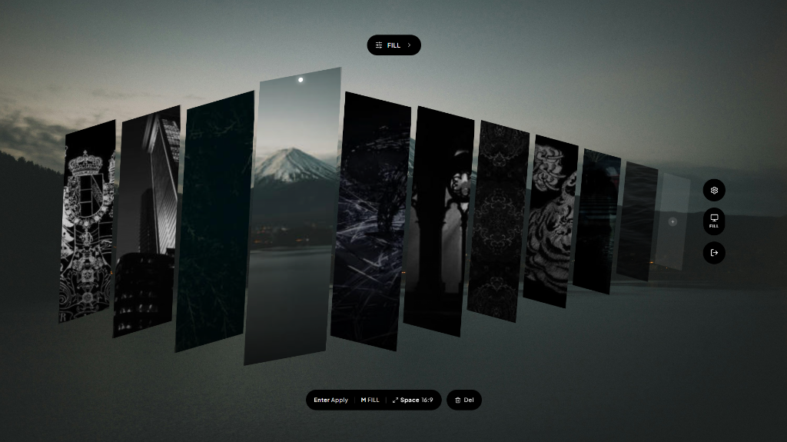

<div align="center">
  
  <h1>MicroSwap</h1>
  <p><strong>Change your desktop wallpaper as easily as skipping a song.</strong></p>
  <br />
  
</div>
<br />

## What is MicroSwap?

MicroSwap is a super lightweight wallpaper switcher for Windows 10 and Windows 11. Most wallpaper apps eat up way too much memory or force you to click through a bulky main window just to swap an image. MicroSwap skips the bloat completely.

The entire app is a floating wave carousel that sits quietly in your system tray until you summon it with a hotkey. When you open it for the very first time, it automatically grabs your current Windows wallpaper so you are ready to go right away. From there, you just drop in your favorite wallpapers, scrub through them with your arrow keys or mouse wheel, and hit Enter to watch your selected image unshear and dissolve right onto your desktop.

## Features

* **Pure Floating Carousel** Everything happens right inside the transparent desktop overlay. There is no clunky main window hogging your RAM in the background.
* **Instant Hotkey Access** Press `Alt + W` from anywhere in Windows to pop open the switcher, pick a look, and get right back to what you were doing.
* **Bouncy Wave Physics** Wallpapers live in a sheared, tilted vertical slice wave that reacts as your cursor moves across it.
* **Drag to Reorder** Grab any slice in the carousel and drag it left or right to arrange your lineup however you like.
* **Built In Windows Fit Modes** Switch between `Fill`, `Fit`, `Stretch`, `Tile`, `Center`, and `Span` right from the top pill or by pressing `M`.
* **Easy Uploads** Navigate onto the Add slice with your arrow keys, drag and drop files straight from File Explorer, or import a whole folder at once (up to 30 slots).
* **Portal Dissolve Animation** When you apply a wallpaper, the slice straightens out, expands across the stage, and smoothly fades into your new desktop background.
* **Fast and Local** Built with Rust, Tauri 2, React, and SQLite. Your wallpapers stay on your drive with zero cloud accounts or tracking.

## Keyboard Shortcuts

| Key | Action |
| :--- | :--- |
| `Alt + W` | Summon or hide the MicroSwap carousel |
| `Left / Right Arrows` | Browse through wallpapers and the Add slice |
| `Enter` | Apply the selected wallpaper (or open file picker on the Add slice) |
| `Space` | Toggle full 16:9 landscape preview on the center slice |
| `M` | Cycle through Windows fit modes (`Fill`, `Fit`, `Stretch`, `Tile`, `Center`, `Span`) |
| `Tab` | Switch between collection filters |
| `Ctrl + Z` | Undo and revert to your previous wallpaper |
| `Delete / Backspace` | Remove the selected wallpaper from the carousel |
| `Escape` | Close the carousel without changing your wallpaper |

## Getting Started

Make sure you have [Node.js](https://nodejs.org/) and [Rust](https://www.rust-lang.org/tools/install) installed on your Windows machine.

```powershell
# Install frontend packages
npm install

# Run MicroSwap in development mode
npm run tauri dev

# Build the production Windows installer and executable
npm run tauri build
```

## Tech Stack

* **Backend** Rust, Tauri 2, rusqlite, image, blake3, Windows Win32 API
* **Frontend** React, TypeScript, Tailwind CSS, Vite
